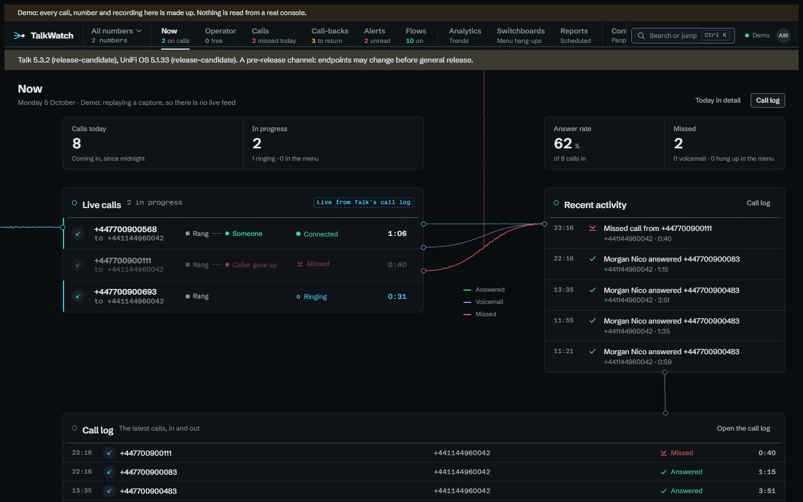
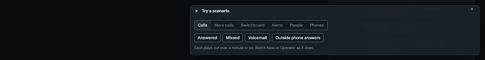
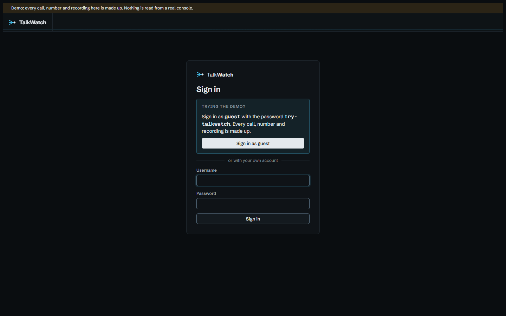

# Trying the demo

You can see TalkWatch working before you point it at a console. Demo mode
replays a capture from a real one that ships in the image: 53 calls, with the
newest moved to an hour ago so the pages have something to show. Every number
in it is fictional and every recording synthetic, and every page says so.



## Starting it

The image has everything the demo needs, so it's the database, the image and
four settings:

```yaml
services:
  db:
    image: postgres:17-alpine
    environment: { POSTGRES_DB: talkwatch, POSTGRES_USER: talkwatch, POSTGRES_PASSWORD: change-me }
  talkwatch:
    image: ghcr.io/thecodesaiyan/talkwatch:latest
    depends_on: [db]
    ports: ["8080:8080"]
    environment:
      ConnectionStrings__TalkWatch: Host=db;Database=talkwatch;Username=talkwatch;Password=change-me
      Demo__Enabled: "true"
      Bootstrap__AdminUsername: admin
      Bootstrap__AdminPassword: a-long-password-of-your-own
```

Then open `http://<host>:8080`.

## What it does

A replay on its own would sit still, so the demo keeps it moving. A new call
arrives every four minutes (`Demo__CallEveryMinutes`), one of each kind in
turn, from missed to answered to hung up in the menu, and calls ring and are
answered on **Now** and **Operator** while you watch, so the example flows have
something to fire on. It starts with example flows, alerts, people holding
roles on the number, and two reports with a copy each to open.

## Trying a scenario

You needn't wait for the next call. A bar at the foot of every page sets a
scenario going, and it plays out in real time on the replayed console, a step
every few seconds, so you can watch it on **Now** or **Operator** as it would
happen on your own phones:

- **Calls**: answered, missed, left as voicemail, or put through to an outside
  phone that answers.
- **More calls**: a call parked and picked up again; a missed call that someone
  then rings back; a call on a poor line; and a rush of six callers in about a
  minute, answered, missed, left as voicemail and through the menu, to see Now
  and Operator busy. The rush counts as one of the four.
- **Switchboard**: a caller presses 1 and then 2, presses a key that isn't an
  option, or hangs up in the menu. Their card rides through the switchboard on
  **Operator** as they choose. Three more change the switchboard's setup for a
  minute. **Out of hours** closes its opening hours, **A prompt loses its
  audio** takes the audio from option 2's prompt, and **A draft option** adds
  a switched-off option 4 with nothing under it. Each shows on its stage's
  badge and in its panel.
- **Alerts**: the missed call and the hang-up during the greeting that the
  example flows alert on, and a caller missed twice in a row.
- **People**: someone in the support team goes do-not-disturb, or is on a
  call, for a minute.
- **Phones**: a desk phone drops off the network for a minute; Talk can't reach
  its cloud services for a minute; or Talk reports it is running degraded. The
  last two show in the strip under the rail, from the next page you open, as
  Talk 5.4.5 reports them.

The bar shows one kind at a time; pick the kind from the row along its top.
Each takes about a minute, and up to four play at once, since everyone trying
the demo shares it. The bar folds down to a tab, and exists only in the demo.



Each scenario goes with a guide, which says what to look for and what to set up
on your own console:

| Play | Then look at | Guide |
|---|---|---|
| **Missed**, **Missed call alert** | **Call-backs**, the pop-up, the *Missed calls* flow | [Getting back to every missed caller](guides/missed-callers.md) |
| **Missed, then called back** | the caller leaving **Call-backs** once they're rung back | [Getting back to every missed caller](guides/missed-callers.md) |
| **Caller tries again** | the *Callers who try again* and *Callers we keep missing* flows | [Getting back to every missed caller](guides/missed-callers.md) |
| **A rush of calls** | **Now** and **Operator** with several callers at once | [Seeing a bad day coming](guides/busy-line.md) |
| **Parked and picked up** | the caller shown Parked on **Now** and **Operator**, then the call's route | [Running the front desk from one screen](guides/front-desk.md) |
| **Presses 1, then 2**, **Presses a wrong key** | **Operator** | [Running the front desk from one screen](guides/front-desk.md) |
| **Out of hours**, **A prompt loses its audio**, **A draft option** | the badges on **Operator**'s switchboard, and each stage's panel | [Running the front desk from one screen](guides/front-desk.md) |
| **Voicemail** | **Now**, the *Voicemail that sounds urgent* flow | [Voicemail that can't wait](guides/voicemail.md) |
| **Hangs up in the menu**, **Hang-up alert** | **Switchboards**, the *Hung up in the menu* flow | [Callers who give up at the switchboard](guides/switchboard.md) |
| **Outside phone answers** | who answered on **Now**, the *Put through to a mobile* flow | [Staff who answer on their mobiles](guides/mobiles.md) |
| **Do not disturb**, **On a call** | **People** on **Operator** and **Now** | [Running the front desk from one screen](guides/front-desk.md) |
| **Poor line**, **Handset goes offline**, **Talk loses its cloud**, **Talk under strain** | the *Poor call quality* flow, the handsets on **Now**, the strip under the rail | [Knowing when the phones themselves go wrong](guides/phone-health.md) |

## The guest account

The sign-in page offers a shared **guest** account, with its password on the
page and a **Sign in as guest** button.

The guest is an admin, so every page and button is there to try. What would
change the site for whoever comes next (people, roles, roles on numbers, group
mappings, retention, the mail and Telegram settings) is refused when it's
saved, with a message saying why, rather than hidden.



## What stays in the demo

Nothing leaves the browser. Alerts arrive only in TalkWatch, channels other
than the browser's own can't be added, test sends are refused, and reports are
kept to read but never emailed.

Every 30 minutes (`Demo__ResetMinutes`) the demo starts over: it clears the
calls, alerts, flows, channels and reports it has gathered and sets the
examples up again, and a banner counts down to it. People and roles are kept,
so nobody is signed out.

The names in the capture were pseudonymised along with the numbers. The demo
gives the switchboards, options and ring group readable names ("Main
switchboard", "1 · Sales and billing", "Support team"), and the people are
stand-ins for whoever answers your phones.

When you're ready for your own console, carry on with [Installing](install.md).
