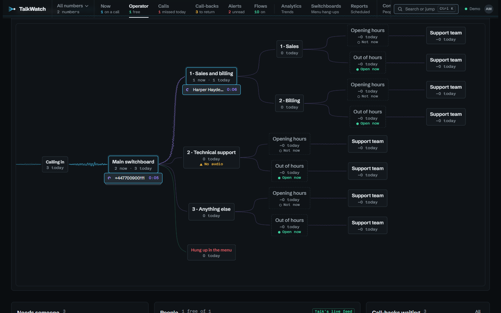
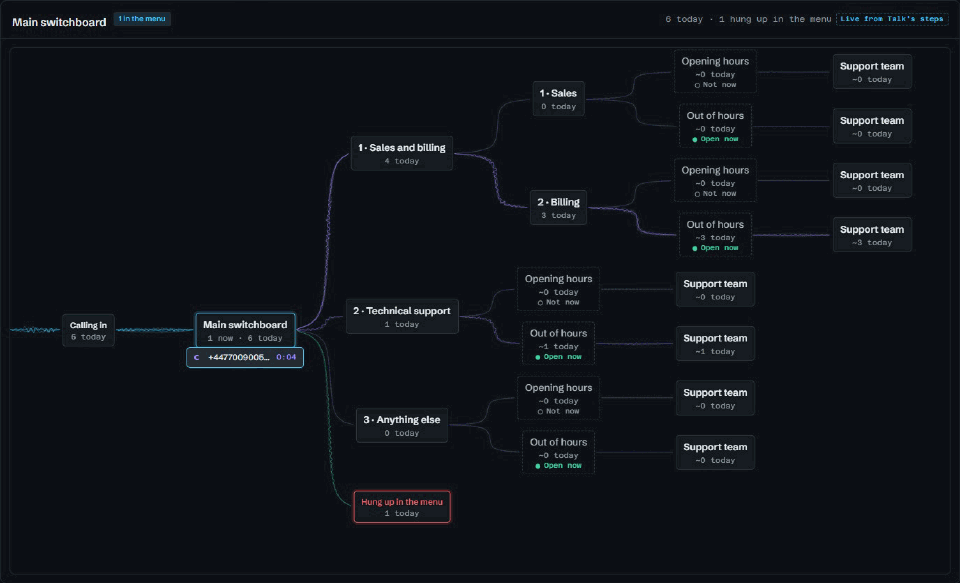
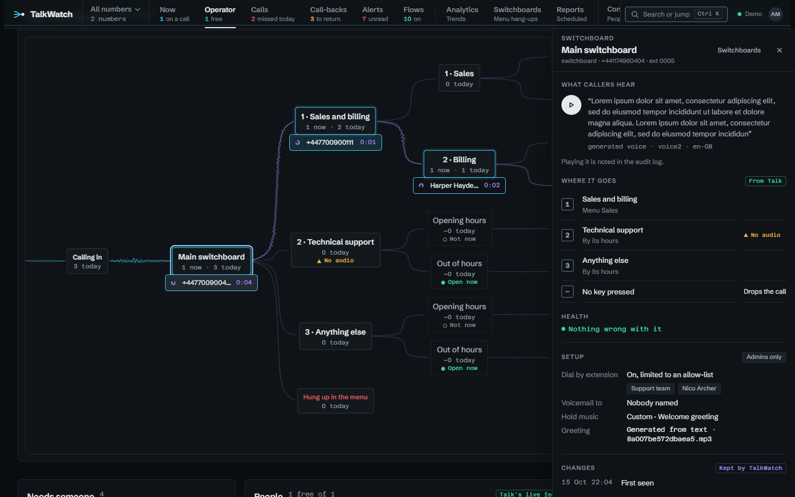

# Operator

**Operator** is the screen for whoever looks after the phones all day: where
callers are in the switchboard, who's free, what's ringing, and who's waiting to
be called back.

## The switchboard, live

Each switchboard the chosen number reaches is drawn as the flow its callers
move through: calls coming in, the menu, each option, and where each option
puts calls through to. The streams between them are busier the more of today's
calls took them.

- Each caller in the switchboard is a card at the stage they last reached, with
  how long they've been there. As Talk reports each key they press, the card
  rides the stream to the option they chose, as calls do on [Now](now.md).
- Where several callers are at one stage, their cards stack: three show and the
  rest are counted. Point at the stack to fan it open and scroll through it.
  Choose a card to open the call beside the page.
- Each stage shows how many calls reached it today. Talk logs nothing when a
  call passes an opening-hours split, so each branch's count is worked out
  from its hours and the time each call came in, and is marked with a `~`.
  The hours are those the branch has now, so a change to them today shifts
  the counts for the calls before it.
- A stage can carry one badge, the most pressing thing about it. An
  opening-hours branch says **Open now** or **Not now**, worked out from its
  hours in the time zone reports use. It says **Hours unknown** when holidays
  are on but TalkWatch can't read their dates, because then it won't guess.
  **Off** means the stage is switched off in Talk. **No audio** and **Audio
  pending** mean its greeting is missing or still being generated. **Goes
  nowhere** means there's nothing to put callers through to.

### A stage's panel

Choose a switchboard stage to open its panel beside the flow, without leaving
the page. It shows what callers hear, with a button to play the greeting.
Each play is written to the audit log, as playing a recording is. It also
shows where each key or branch goes and what happens when a caller presses
nothing. Then come the week's opening hours, with the time zone they're read
in, and anything wrong with the stage. Esc closes it.

Someone who may see every line's calls also sees the setup: who a caller may
reach by dialling an extension, who gets voicemail, the hold music and the
greeting's file. They also see what a switched-off stage would raise if it
were switched on. Then there's a list of changes. TalkWatch keeps a copy of
each stage's setup whenever it changes, so the list can say when a greeting
changed or a stage was switched off. The copies are kept as long as calls
are; see [Retention](retention.md). Anyone else's panel doesn't hold any of
this, so it never reaches their browser.

## Who's free, and who's waiting

- **Needs someone** comes first: calls ringing or waiting that nobody has
  picked up. Then **In progress**.
- **People** are grouped by ring group, with each person's presence, so you can
  see which team has someone free. With a number chosen in the switcher, only
  the groups and people a call to that number can reach are shown. Paging
  groups never count as teams, since they take no calls.
- Outside numbers that a group or switchboard forwards to, someone's mobile,
  say, are shown as **Outside number · forward** and listed under
  **Forwarded to**. Talk knows nothing about their presence, so they're never
  counted as free.
- **Call-backs waiting** sits on the right, longest first.

TalkWatch reads Talk and never controls it. Answering and transferring stay on
the handset.

## Guides

- [Running the front desk from one screen](guides/front-desk.md)
- [Callers who give up at the switchboard](guides/switchboard.md)
